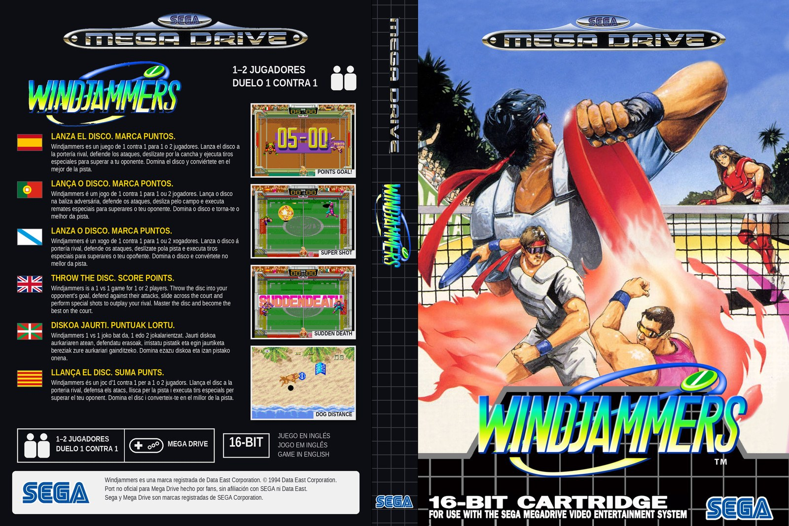
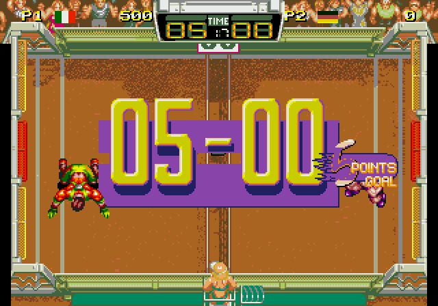
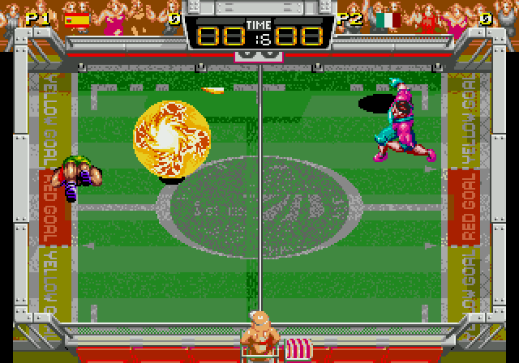
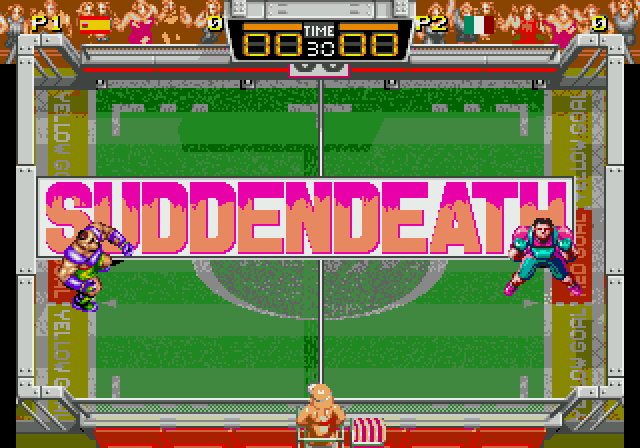
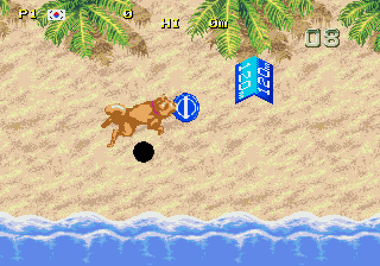

# WindjammersMD

**Windjammers for Mega Drive**



A Mega Drive / Genesis port of Data East's *Windjammers* (Neo Geo, 1994), built from **your own** copy of the Neo Geo ROM.

This repository contains **no game data**. It has original engine code (C/68000 assembly), build
tools, and a manifest of *offsets, frame numbers and markers* in the original ROM. Everything you
see and hear is converted from your ROM set at build time into `build/` (git-ignored, like the ROMs).

The output, `windjammers.bin`, runs in Mega Drive emulators and on real hardware through a flash
cart. It is 6.5 MB (6656 KB) and uses the standard Sega mapper ("SEGA SSF" in the header), so the cart must
support ROMs above 4 MB with that mapper (Mega EverDrive X5/X7/Pro, and emulators such as Genesis
Plus GX and BlastEm do). On a Mega EverDrive X5 a 7.3 MB build was refused as too large while 6.5 MB
(6656 KB) works, so keep the ROM at or under that.

| | |
|---|---|
|  |  |
|  |  |

## Building

You need the MAME `wjammers` set (zip or directory) and the Neo Geo MVS BIOS. Without them nothing is
built: `make` stops and asks for `ROM=`.

Requirements: Python 3 with Pillow, GNU make, gcc (for the host tools), git, and an m68k cross GCC.

```sh
git clone <this repository> windjammersmd && cd windjammersmd
tools/setup_toolchain.sh                      # fetches a cross gcc into .toolchain/ (Debian/Ubuntu, no root),
                                              # plus the Z80 and 68000 emulator cores used at build time
make ROM=path/to/wjammers.zip BIOS=path/to/neogeo.zip   # a MAME .zip or a directory of ROM files
```

The ROM files are identified by CRC32: MAME set `wjammers` (`065-p1`, `065-c1`..`c4`, `065-s1`,
`065-m1`, `065-v1`..`v4`) and, from MAME's `neogeo` set, the MVS BIOS `sp-s2.sp1`, `sfix.sfix` and
`000-lo.lo`. `BIOS` defaults to `ROM` (fine if the BIOS files sit in the same folder).

A full build takes a few minutes: it runs the original game to record its screens.

## Controls

Three Mega Drive buttons. OPTIONS (in GAME MODE SELECT) sets which one throws and which one lobs:
type 1 A / B (as the arcade), type 2 B / C, type 3 C / B; the remaining button lobs too. HOW TO
PLAY (shown after Start as in the arcade, and in OPTIONS) explains everything with the original's
demonstrations. OPTIONS also sets the LEVEL (1-8, 4 as the arcade's default) of the computer.

| Button | Without the disc | Holding the disc |
|---|---|---|
| D-pad | run | aim |
| Throw | slide (with a direction) | throw: straight, up/down for 45 degrees, plus forward/back for 22.5/67.5 degrees |
| Lob | | lob (straight, or up/down) |
| Start | pause | |

**Super shot**, as in the original: slide into the incoming disc and it flies up instead of being
caught; stand under it, catch it as it comes down, and your next throw is your character's super
shot (the opponent can steal it the same way). Left to land, it is 2 points against that half.

Curve throw: turn the stick through a quarter circle (for example down, down-forward, forward) and
press A; the disc bends the way the stick turned, by as much as your character's curve power, and
flies straight on once it hits a wall.

Throwing right after a catch is a fast power throw; the longer you hold the disc, the slower the
throw (each character has its own speeds, taken from the original).

In 1P mode you play 6 rounds, one against each character (yourself included), the last one ROUND
FINAL. After round 2 comes the DOG DISTANCE bonus round: press A as soon as you get the disc for a
power throw (the longer you wait, the shorter the throw), then steer the dog with the D-pad and jump
with A, B or C. Catching the disc just as it lands is a 5000 TECHNICAL POINT, in a jump 10000;
running into a sunbather trips the dog and slows the disc. After round 4, FLYING DISC BOWLING:
40 seconds of bowling with the disc (aim with up/down, throw with A).

Rules, as in the original: centre goal 5 points, sides 3 points, a lob that lands is 2 points. A set
ends at 12 points or when time is up (at the next catch or point). A tied set counts for both
players, so 1-1 leads to SET FINAL and 2-2 to a SUDDEN DEATH set (first point wins); a tie there is a
DRAW GAME. Two sets win the match. As in the arcade, the orange bar above a player's score lights up
once that player has a set, and a big TIME box flashes the time at the start of a set (30), at 15 and
from 10 to TIME UP.

The number next to each flag is the arcade's score: 100 a point, 1000 for each point past the 12-point
goal, 5000 plus 100 a second left for a set; in 1P it carries over between rounds, its last digit
counts the rounds won (10000 more for a 2-0 round), and the bonus rounds add their points.

The RANKING TOP5 of the attract loop is live, as in the arcade, and like the arcade it lives in RAM:
it starts from the five "D.E" entries each time the console is switched on. A 1P score good enough
for it gets a NAME, after a lost match (in P1's corner, before CONTINUE) or after the ending: left
and right choose a letter, A enters it, "ED" finishes early; after 30 seconds the letter shown is
taken.

## How it works

Neo Geo and Mega Drive both have a 68000 and a 320×224 screen, but the video, sound and memory are
very different, so the game logic is reimplemented. The original is used as much as possible:

- **`tools/ngrec/`** — a small headless Neo Geo (Musashi 68000 core, Z80 core, video chip, MVS BIOS)
  that runs the original game at build time with scripted inputs and records its screens, video RAM,
  work RAM and sound commands.
- **`tools/mkmovies.py`, `tools/mkmovie.py`** — turn recorded scenes into Mega Drive "tile movies"
  (Neo Geo intro, Data East logo, title, profiles, ranking, court roulette), still screens with cut-out
  sprites (player select, VS screen), the courts as seen in a match, the HUD, score and set banners, the
  characters' super shots (path and effects) and the frisbee dog bonus demo.
- **`tools/mksound.py`** — runs the original Z80 sound driver (`tools/snd/sndsim.c`) and converts what it
  plays: FM to the YM2612, SSG to the PSG, the ADPCM-B instruments to an FM voice, ADPCM-A drums, voices
  and effects to 8-bit samples.
- **`tools/extract.py`** — character animations (the game's own animation scripts) and fonts.
- **`tools/mkbanks.py`** — packs the big data tightly into the ROM after the code, so that each item can
  be read through one of the Sega mapper's windows.
- **`tools/manifest_wjammers.py`** — where things are in the ROM: offsets, frame numbers, tables.
- **`tools/re/`** — reverse-engineering helpers (frame viewers, VRAM/RAM inspection, MAME scripts).
- **`src/`** — the Mega Drive program (no SDK: `crt0.s`, VDP/DMA, mapper, movie player, sound player,
  match engine, menus).

Tip for development: `make CFLAGS_EXTRA=-DTEST_DEMO=0x0005` builds a ROM that runs a CPU-vs-CPU match
(characters 0 vs 5) straight away.

## Status

The arcade's attract loop, menus, select screens, matches against the CPU and between two players,
voices and music are in, with both bonus rounds and the ending. Approximations of our own: how the
bowling pins knock each other over, and the exact catch distances. (The original has no hidden
character: "S.MILLER" in its ROM is a name in the staff credits.)

## Case insert

`docs/insert/` has a printable insert for a PAL Mega Drive case: back, spine and front in one sheet,
274 × 183 mm (129 mm back + 16 mm spine + 129 mm front) at 300 dpi, as
[PDF](docs/insert/windjammers_insert.pdf) and [PNG](docs/insert/windjammers_insert.png). It has no
bleed; add about 3 mm per side if the print shop needs it, and check the spine of your case. The
back's screenshots (also in `docs/screenshots/`) are frames of this port running in an emulator.

## Credits

- Front cover art of the insert: [Zanac](https://x.com/zanac_dx) ([@zanac_dx](https://x.com/zanac_dx)).
- Port engine, build tools and insert layout made with [Claude](https://claude.ai) (Anthropic) via Claude Code.

This is an unofficial fan project, not affiliated with SEGA or Data East. Windjammers © 1994 Data East
Corporation; Sega and Mega Drive are trademarks of SEGA Corporation.
